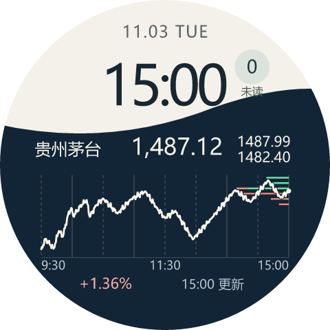
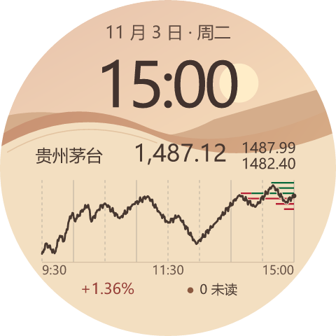
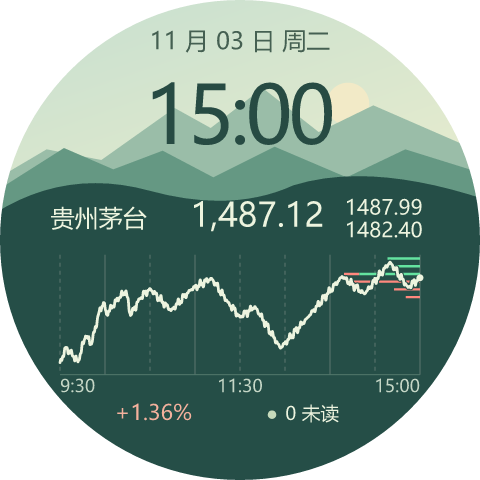
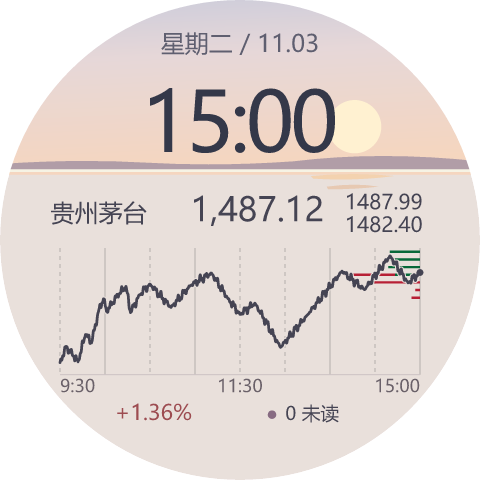

# 息屏 K 线 · 腕上盯盘

在三星手机上，熄屏、点亮锁屏或插电进入屏保时，都可以看到同一组自选股。每只股票可单独选完整图或单行 Mini K。手表端可独立查看 K 线、切换表盘和接收策略消息。

## 下载安装

| 装在哪里 | 下载 | 适用设备 |
| --- | --- | --- |
| 手机 | [息屏 K 线 v1.25](https://github.com/kevin249/SamsungPhoneStock/releases/download/phone-v1.25/phone-kline.apk) | Android 8.0 及以上。三星息屏组件需要支持 Good Lock / LockStar 的机型 |
| 手表 | [腕上盯盘 v0.6.7](https://github.com/kevin249/SamsungPhoneStock/releases/download/phone-v1.25/watch-mcp.apk) | Wear OS，Android API 30 及以上，如 Galaxy Watch4 系列 |
| 手表表盘 | [昼夜折面](https://github.com/kevin249/SamsungPhoneStock/releases/download/phone-v1.25/dial-fold.apk) · [砂丘地平线](https://github.com/kevin249/SamsungPhoneStock/releases/download/phone-v1.25/dial-dune.apk) · [青岚山脊](https://github.com/kevin249/SamsungPhoneStock/releases/download/phone-v1.25/dial-ridge.apk) · [盐湖倒影](https://github.com/kevin249/SamsungPhoneStock/releases/download/phone-v1.25/dial-salt.apk) | 四款表盘均为 v1.4，需要 Wear OS 4 及以上，行情由「腕上盯盘」提供 |

只用手机时，下载并打开手机 APK 即可。首次使用可直接看公开行情。完整安装包与文件校验值见 [v1.25 发布页](https://github.com/kevin249/SamsungPhoneStock/releases/tag/phone-v1.25)和 [SHA-256 清单](https://github.com/kevin249/SamsungPhoneStock/releases/download/phone-v1.25/SHA256SUMS.txt)。

## 手机上配置行情

1. 打开「息屏 K 线 → 显示 → ＋ 添加股票」，按代码、中文名、拼音或首字母搜索。可继续添加多只，用每行的「⇅」调整先后顺序。
2. 为每只股票选择样式。**完整图**适合看价格走势、刻度和指标。**单行 Mini K** 将名称、分时走势、涨跌幅和现价排在一行，适合放在重点股票下方。
3. 点对应股票的「完整图高度」调整。默认 **332 dp**，也可选 104 至 312 dp 的固定档位，或选「自动」填满剩余空间。Mini K 每行占 26 dp。卡片放不下时，先为 Mini K 留出空间，再按比例缩小完整图。若仍无法为每张完整图留出至少 32 dp，剩余股票按原顺序排到下一页。

例如，保留一张默认完整图并在下面放两行 Mini K，行情内容需要约 384 dp。将系统卡片调得更矮，完整图会随之缩小，两行报价仍各占一行。

### 让 AOD、锁屏和充电屏保显示一致

1. 在三星系统「设置 → 锁定屏幕和息屏提醒」开启息屏显示（AOD）。在 Good Lock（好锁）启用 LockStar。应用内「后台 → 添加到息屏显示」也可打开设置指引。
2. 在三星锁屏编辑器进入「LockStar → 息屏提醒 → 应用程序小组件」，选择「息屏 K 线 → 息屏行情」。把组件放在屏幕上半部，拖动边角设定显示区域，然后点「完成」。菜单名称随 One UI 版本略有差异。
3. 要使用充电屏保，打开应用「显示 → 充电屏保 → 系统屏保设置」，选择本应用并设置充电时启动。接入电源，等待屏幕自然超时即可查看。

配置后，三处共用同一张行情卡片，股票顺序、当前页和图高相同。AOD 亮度由三星系统控制，充电屏保保留自己的时钟。息屏与点亮之间切换会保留当前页。多页行情在同一屏幕状态下显示满 30 秒后，于下一次行情或系统刷新时翻页。

**人脸识别后上滑解锁**时，从行情组件下方留出的空白区域起手。行情本身只读，但 LockStar 外框也占用触摸区域。如果上滑仍停在锁屏，回到编辑器，把组件上移或收短，给平时起手的位置留出空间。[三星小组件说明](https://www.samsung.com/uk/mobile-phone-buying-guide/what-are-widgets/)

也可以独立使用动态壁纸或充电屏保。在「显示」选择主题后，点「锁屏壁纸 → 应用到锁屏」或「充电屏保 → 系统屏保设置」。未添加 LockStar 行情组件时，这两处使用主题布局，每 15 秒轮换一页。桌面也可添加「息屏行情」，点击「下一页」切换。

### 图表与盘中更新

| 想调整什么 | 在哪里设置 |
| --- | --- |
| 分时、1 分钟或日 K | 「行情 → 图表显示」。开启「自动切换实时 / 日 K」后，交易日上海时间 09:15–15:00 显示实时图（含午休），其余时间显示日 K。关闭后使用手选类型 |
| 看均线、盘口和买卖点 | 日 K 显示 MA5、MA10、MA20。分时和分钟图可分别开启千档挂单与 B/S 策略信号，两者需要兼容的实时接口 |
| 息屏时持续更新 | 「后台 → 持续更新息屏行情」，按提示允许通知和按开盘时间自动启动。盘中更新结束后保留缓存，下一交易时段恢复 |
| 调整取数频率 | 「行情 → 行情获取间隔」分别设置充电和未充电频率，默认每 0.2 秒和 0.5 秒请求一次。实际到达时间受行情源、网络及系统调度影响 |

三星组件里的分时和 1 分钟图按 09:30–15:00 排列，折叠午休，尚未交易的时段留空。完整图里的 TDW 动力线用箭头标记指标穿越阈值的位置，可参考[独立充电屏保的实机图](design/phone-modes/114-charging-device.png)。

## 在手表上使用

手表和电脑连接同一 Wi-Fi，在手表开发者选项开启 ADB 调试和无线调试，选择「配对新设备」。将 Android SDK 的 `platform-tools` 加入电脑的 `PATH`，在下载 APK 的目录打开 PowerShell，依次执行以下命令。配对端口在配对页，连接端口在无线调试主页，按手表显示的实际值填写。

```powershell
adb pair 手表IP:配对端口
# 按提示输入配对码，然后返回手表的无线调试主页
$watch = '手表IP:连接端口'
adb connect $watch
adb -s $watch install -r .\watch-mcp.apk
adb -s $watch install -r .\dial-fold.apk
```

最后一行可换成喜欢的表盘文件，四款可同时安装。长按手表主屏，在「添加表盘」中选择。日常使用时手表独立联网，可以关闭无线调试。

| 02 昼夜折面 | 07 砂丘地平线 | 16 青岚山脊 | 17 盐湖倒影 |
| :---: | :---: | :---: | :---: |
|  |  |  |  |

- **在「腕上盯盘」里**，顶部菜单可管理股票和周期。日 K、周 K、1 分钟和 5 分钟图显示最近 48 根。上滑看下一只，下滑看上一只，左滑看消息，右滑返回。
- **在系统表盘上**，亮屏时双击图表切到下一只，轻点未读区域查看消息。在系统「自定义」内选择图表、千档挂单和买卖标记。
- **需要消息提醒时**，先配置 MCP，再打开顶部菜单「后台通知设置」并允许通知及后台联网。手表保存最近 100 条消息并按事件去重，后台接收会增加耗电。

## 实时接口与隐私

公开 K 线开箱可用。若要看逐笔成交、千档盘口、策略买卖点或接收通知，请准备自己的 HTTPS MCP 服务和客户端 Key。在手机「行情 → 配置实时接口」和手表顶部菜单「MCP 接口设置」分别填写。两端各自保存配置，客户端 Key 使用本机 Android Keystore 加密，应用禁用备份。发布包不含预设服务地址或 Key。

自建服务需支持 Streamable HTTP MCP，并按使用的功能提供对应工具。行情使用 `get_tdx_kline`、`get_tdx_snapshot`、`get_stock_active_trades` 和 `get_tdx_depth`，交易日历使用 `get_tdx_trading_calendar`。消息使用 `get_notification_stream` 返回的资源地址，客户端按更新通知读取资源。字段解析见[手机实时客户端](phone/src/main/java/com/kevin/phonekline/PhoneMcpClient.java)和[手表行情客户端](wear/src/main/java/com/kevin/watchmcp/DialMarket.java)。

## 从源码构建

准备 JDK 17、Android SDK Platform 34 和 Build Tools 34.0.0。将 `JAVA_HOME`、`ANDROID_HOME` 分别指向 JDK 和 SDK 目录。在 Windows PowerShell 中执行以下命令。

```powershell
git clone https://github.com/kevin249/SamsungPhoneStock.git
cd SamsungPhoneStock
.\scripts\build.ps1
```

脚本构建手机应用、手表应用和四款表盘，同时运行 Android Lint 和单元测试，将六个 APK 放入 `dist/`。macOS 或 Linux 可在仓库根目录运行 `./gradlew assembleDebug lintDebug testDebugUnitTest`，从各模块的 `build/outputs/apk/` 取包。

仅构建和检查手机应用，可在仓库根目录运行 `.\gradlew.bat :phone:assembleDebug :phone:lintDebug :phone:testDebugUnitTest`。给已配对的手表一次安装所有兼容的包，可运行 `.\scripts\install-watch.ps1 -Device $watch`。安装脚本同时将手表应用加入电池优化豁免，以便熄屏联网。单独配置手表接口可用 `.\scripts\configure-watch-mcp.ps1 -Device $watch -McpUrl $mcpUrl`，其中 `$mcpUrl` 为自己的 HTTPS 服务地址，脚本会提示输入 Key。

| 目录 | 内容 |
| --- | --- |
| [phone/](phone/) | 手机应用、桌面与 LockStar 行情组件、动态壁纸和充电屏保 |
| [wear/](wear/) · [watchface/](watchface/) | 独立手表客户端、行情数据源与四款 Watch Face Format v1 表盘 |
| [shared/](shared/) · [scripts/](scripts/) | 共用股票搜索等代码，以及构建、安装和配置脚本 |
| [tests/](tests/) · [bridge/](bridge/) | 测试服务及早期电脑桥接实现。当前手机和手表直接访问行情服务 |

本项目使用 [MIT 许可证](LICENSE)。行情实现参考 [wenzidingpan](https://github.com/kevin249/wenzidingpan)，复用说明见[第三方声明](THIRD_PARTY_NOTICES.md)。
