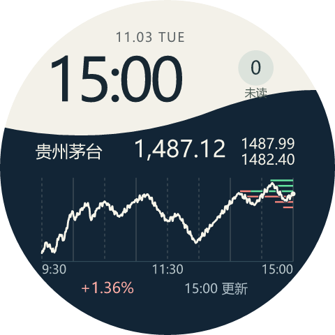
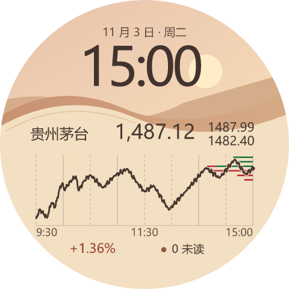
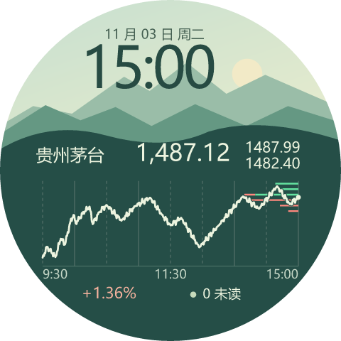
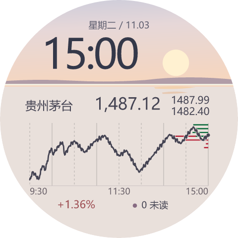
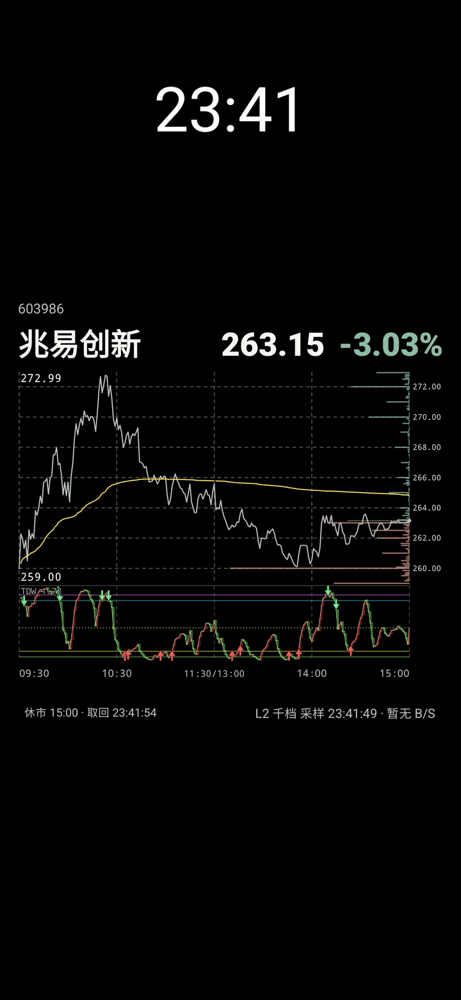

# 腕上盯盘 · SamsungPhoneStock

参考 [wenzidingpan](https://github.com/kevin249/wenzidingpan)，支持 Galaxy Watch4 及更新的 Wear OS 手表（最低 API 30）。**0.2.0 起手表独立联网，不需要电脑桥接或电脑常开。**

开源版不预置 MCP 服务地址或客户端 Key。公开 K 线可独立使用。MCP 通知、实时快照、千档盘口和交易日历需要配置自己的兼容服务。手表与手机各自在本机保存接口配置。

## 表盘预览

四款独立表盘可同时安装，长按手表主屏即可切换。以下为盘面预览，图中的行情为示例。

| 02 昼夜折面 | 07 砂丘地平线 |
| :---: | :---: |
|  |  |
| **16 青岚山脊** | **17 盐湖倒影** |
|  |  |

## APK 下载

### 三星手机行情与锁屏壁纸

在 Android 8.0 及以上手机上安装 [phone-kline.apk（手机 v1.15）](https://github.com/kevin249/SamsungPhoneStock/releases/download/phone-v1.15/phone-kline.apk)，打开「息屏 K 线」。可在[该版本的 Release](https://github.com/kevin249/SamsungPhoneStock/releases/tag/phone-v1.15) 下载 SHA-256 校验清单，也可按下方「开发和验证」自行构建。

手机支持三星息屏行情（AOD）、亮屏锁定时的动态壁纸和充电闲置时的屏保。三种模式共用股票、图表和取数设置。锁屏壁纸与充电屏保另有一个共用主题选择器。

「行情设置」支持按代码、中文名、拼音全拼或首字母查找股票。「1 分钟 K 线」在全屏主题中显示最近 60 根分钟蜡烛，在三星息屏行情小组件中按当天交易时间定位。小组件的两种图都从左侧 09:30 延伸到右侧 15:00，折叠午休，尚无数据的时段留空。「显示千档挂单」与「显示 B/S 买卖标记」可分别开关。

锁屏壁纸与充电屏保把全天最高价、最低价放在图内左上角和左下角。盘口和走势共用价格轴，买卖挂单从绘图区右缘向左展开，条长与挂单量成正比。挤在同一细行里的同侧挂单按量加权定位，右侧另列价格刻度。

#### B/S 箭头与 TDW「逃顶王」

主图的 B/S 来自 MCP 策略信号。打开「显示 B/S 买卖标记」后，红色向上箭头表示买入，绿色向下箭头表示卖出。

TDW 使用当前股票的一分钟行情在手机本地计算。锁屏壁纸和充电屏保的 K 线、分时模式均在主图下方显示等宽副图，共用时间轴。三星息屏小组件在 K 线模式下显示 TDW。

- **动力线**为 `EMA(4 × (收盘价 − 近 10 根最低价) / (近 25 根最高价 − 近 10 根最低价), 4)`。灰线显示数值，相邻两根之间用空心柱表示变化，上升为红色，持平或下降为绿色。
- **副图箭头**标记动力线穿越阈值的位置。上穿 0.2「底部」或 0.5「关注」画红色向上箭头，下穿 3.2「阶段卖出」或 3.5「清仓卖出」画绿色向下箭头。四个条件各自独立过滤，触发后 20 根内跳过同一条件的重复信号。1.75 点线标示强弱分界。



#### 手机显示与取数设置

- **按侧键查看三星息屏行情**。开启三星息屏显示。在 Good Lock（好锁）的 LockStar 中进入「息屏提醒 → 应用程序小组件」，添加「息屏 K 线 → 息屏行情」，拖动边角放大后点「完成」。系统时钟下方显示报价，图内左上是全天最高价、左下是全天最低价。图下分列报价时间和盘口采样时间。LockStar 在息屏时会调暗整个小组件，编辑器的预览会更亮。[三星 LockStar 小组件说明](https://www.samsung.com/uk/mobile-phone-buying-guide/what-are-widgets/)
- **息屏小组件的盘中持续更新**。在「三星息屏行情」中打开「盘中持续更新息屏行情」，允许通知和按开盘时间自动启动。确认交易日后，手机在上海时间 09:30–11:30、13:00–15:00 保持小组件行情连接，并显示常驻通知。应用提交两帧的间隔至少为 1 秒。午休、收盘或关闭持续更新后，小组件恢复系统定时刷新。暂停行情会停止获取。
- **锁屏动态壁纸**。点「共用主题」选择样式。首次安装默认 114「纯黑行情」，也可选 115「深灰网格」、95「深夜书店」、96「雨停便利店」、100「桥影」、101「面摊」或 102「跨江索道」。点「设置系统壁纸」，在系统选择器中选择锁屏位置。亮屏锁定时由系统显示时钟，壁纸绘制行情。
- **充电屏保**。点「预览充电屏保」查看所选主题的行情和时钟。点「充电屏保设置」，在系统中选择本应用和充电触发条件。接入电源并等待屏幕自然超时后，系统启动屏保。若希望插电期间关闭 AOD，可在三星「模式和日常程序」中添加充电时关闭「息屏提醒」的规则，结束时恢复原设置。
- **行情获取间隔**可按供电状态分别设置。充电时默认 0.2 秒，未充电时默认 0.5 秒。两档均可选 1 秒、0.5 秒、0.2 秒或 0.1 秒，插拔电源后自动切换。间隔表示发起请求的目标间隔。设置页分别统计逐笔和盘口在最近 1 秒内发出的请求数和成功返回数。
- **实时接口**使用手机上配置的 HTTPS MCP 服务和客户端 Key。交易时段分别按所选间隔获取逐笔成交和千档盘口，逐笔成交更新当前分钟蜡烛。锁屏动态壁纸或充电屏保显示期间，午休和收盘后也按所选间隔获取盘口。图例中的「采样」是数据源的盘口时间，图下的「取回」是手机成功收到该次盘口的时间，显示到秒。B/S 来自当前标的真实策略信号，按时间和价格定位。
- **公开行情**可独立提供分钟 K 线。MCP 工具包括 `get_stock_active_trades`、`get_tdx_kline`、`get_tdx_snapshot`、`get_tdx_depth` 和通知资源。手机使用 Android Keystore 加密保存 Key，原图中的演示价格和盘口不会写入运行界面。

### Wear OS 手表安装包

打开 [最新 Release](https://github.com/kevin249/SamsungPhoneStock/releases/latest) 下载，或使用下面的直接下载链接。安装包安装到 **Wear OS 手表**。

| 安装包 | 内容 | 系统要求 |
| --- | --- | --- |
| [watch-mcp.apk](https://github.com/kevin249/SamsungPhoneStock/releases/latest/download/watch-mcp.apk) | 腕上盯盘应用 v0.6.6；为表盘提供行情和消息数据 | Android API 30 及以上的 Wear OS 手表 |
| [dial-fold.apk](https://github.com/kevin249/SamsungPhoneStock/releases/latest/download/dial-fold.apk) | 02 昼夜折面 v1.3 | Wear OS 4 及以上 |
| [dial-dune.apk](https://github.com/kevin249/SamsungPhoneStock/releases/latest/download/dial-dune.apk) | 07 砂丘地平线 v1.3 | Wear OS 4 及以上 |
| [dial-ridge.apk](https://github.com/kevin249/SamsungPhoneStock/releases/latest/download/dial-ridge.apk) | 16 青岚山脊 v1.3 | Wear OS 4 及以上 |
| [dial-salt.apk](https://github.com/kevin249/SamsungPhoneStock/releases/latest/download/dial-salt.apk) | 17 盐湖倒影 v1.3 | Wear OS 4 及以上 |

Release 附有 [SHA256SUMS.txt](https://github.com/kevin249/SamsungPhoneStock/releases/latest/download/SHA256SUMS.txt) 校验文件。当前提供已签名的 Debug 构建，用于 ADB 侧载。先安装 `watch-mcp.apk`，再安装喜欢的表盘；表盘行情和消息需要在应用内配置自己的 MCP 服务。

## 功能

- 默认显示最近 48 根日 K，红涨绿跌；支持日 K、周 K、1 分钟和 5 分钟。
- K 线页上滑切换下一只自选股，下滑切换上一只，按自选顺序首尾循环；左滑查看 MCP 通知，右滑返回，通知页上下滑动仍为滚动消息。顶部菜单「股票列表」合并切换和自选管理：左侧两行显示名称、代码，点击切换；右侧「↑」上移一位（第一只再上移则移到末尾，顺序自动保存），「−」直接删除，顶部「+」支持按代码、名称、拼音和拼音首字母搜索添加。另可切换周期和 MCP 设置。
- K 线由手表直连东财，失败时降级腾讯和新浪，失败保留最后一帧。
- MCP 由手表直连配置的 URL，支持新版 `subscriptions/listen`、旧版 `initialize/resources/subscribe`，收到更新信号立即读取消息，每 10 秒重读资源补漏。
- 最近 100 条通知，支持正文滚动、事件 ID 去重和未读数。
- 0.4.0 起通过独立前台服务持续接收 MCP；切到后台或熄屏仍接收，新消息以系统通知震动提醒。首次历史同步及重复消息不重复震动。
- 0.5.0 起后台接收开启期间持续请求 Wi-Fi；有已验证可上网的 Wi-Fi 就绑定使用，断开或失去互联网验证时优先切手机蓝牙，恢复后切回 Wi-Fi 并重建 MCP 订阅。行情也使用所选网络；两者都不可用时可使用其他已验证网络。
- 客户端 Key 用手表 Android Keystore 加密，禁用备份，不写入源码或日志。

四款表盘适用于 Wear OS 4 及更新版本。长按盘面中央可选择「02 昼夜折面」「07 砂丘地平线」「16 青岚山脊」或「17 盐湖倒影」。进入系统「自定义」可分别设置行情图、千档挂单分布和 MCP 买卖标记。选完短按手表主屏键返回，每款独立保存。亮屏时双击图表，按「腕上盯盘 → 股票列表」的顺序切到下一只，末尾回到第一只。点未读区域可看消息。股价后的小字上方为最高、下方为最低，底部日期和时间标明行情所属交易日。

新表盘默认选中「实时分时」，千档挂单和 MCP 买卖标记均选「显示」。千档盘口按实际返回的买卖档位分别累加，再按价位画成细横条；每侧最多 1,000 档。纵轴始终按 K 线的最高、最低价自适应，千档只显示此价格范围内的挂单，远端挂单不会压扁 K 线。盘前分时仍为最近交易日，盘口可来自当天盘前采集的快照。

表盘默认显示分时线，固定 9:30 至 15:00，午休折叠。MCP 买入信号用红色向上三角，卖出用绿色向下三角。0.6.6 起，通过已配置的 MCP 读取通达信实际交易日历，只在日历确认当天开市、上海时间为 09:30–11:30 或 13:00–15:00 且亮屏时每 1 秒刷新当前股票，同步更新当前一分钟蜡烛；11:30 和 15:00 起停止秒级轮询。分钟历史和千档盘口在交易时段内每 10 秒补齐，熄屏按 30 秒请求更新。节假日、周末、盘前、午休及收盘后，有行情缓存时每 15 分钟更新，无缓存时每分钟重试；反复亮屏不会绕过此限制，切换股票仍立即加载当前股票。

交易日历保存于手表本地，断网沿用已经确认的日期，不按周一到周五或调休工作日推断开市。接口可能只返回已发生的交易日，尚未覆盖的日期按未知处理；日历读取失败、缓存损坏或当天未获确认时，行情保持低频。已确认当天日历每天校验，未知日期在日内交易窗口每分钟尝试确认，其他时间每 15 分钟重试；确认开市后自动恢复正常刷新。日历请求不查询任何股票。

只请求当前显示的股票，切换后取消旧股票请求、丢弃迟到结果，不遍历或预取其他自选股。慢请求期间不堆积新请求；实际到达时间仍取决于网络、行情源和系统调度。手表应用内的独立 K 线页仍按选定周期显示最近 48 根，「较前根」指相对前一根收盘价的变化。

## 安装和设置

从上方 Release 下载 `watch-mcp.apk` 和所需表盘 APK 到同一文件夹，并将 Android SDK 的 `platform-tools` 加入 `PATH`。也可按下方「开发和验证」自行构建。

1. 手表与电脑连接同一 Wi-Fi。
2. 手表「设置 → 关于手表 → 软件信息」，连续点击「软件版本」5 次。
3. 在开发者选项开启 ADB 调试和无线调试，进入「配对新设备」。

```powershell
$adb = 'adb'
& $adb pair 手表IP:配对端口
# 按提示输入手表配对码
```

返回无线调试主页，使用主页上的连接端口（通常不同于配对端口）。在下载 APK 的文件夹打开 PowerShell，先安装应用，再安装所需表盘：

```powershell
$device = '手表IP:连接端口'
& $adb connect $device
& $adb -s $device install -r .\watch-mcp.apk
& $adb -s $device install -r .\dial-fold.apk
# 其他表盘可同样安装：dial-dune.apk、dial-ridge.apk、dial-salt.apk
```

安装后，长按手表主屏，在「添加表盘」中选择对应名称。首次打开「腕上盯盘」完成通知权限和 MCP 设置；表盘数据由此应用提供。

已克隆源码的用户，也可将下载的五个 APK 放入项目 `dist/` 文件夹，或先完成构建，再用脚本一次安装应用和全部表盘：

```powershell
cd SamsungPhoneStock
.\scripts\install-watch.ps1 -Device '手表IP:连接端口'
```

如需安装时同时配置 MCP，请显式传入自己的地址：

```powershell
$mcpUrl = Read-Host '输入自己的 HTTPS MCP URL'
.\scripts\install-watch.ps1 -Device '手表IP:连接端口' -ConfigureMcp -McpUrl $mcpUrl
```

脚本询问 Key，输入不回显；仅配置手表，不启动电脑服务或保存电脑 Key 文件。未配置完整的地址和 Key 时，不连接 MCP。

已安装，只配置手表 MCP：

```powershell
$mcpUrl = Read-Host '输入自己的 HTTPS MCP URL'
.\scripts\configure-watch-mcp.ps1 -Device '手表IP:连接端口' -McpUrl $mcpUrl
```

也可在手表点击顶部 →「MCP 接口设置」，填写 MCP URL 和客户端 Key 并保存。仅更新安装包时省略 `-ConfigureMcp`，保留现有设置。安装后可以关闭无线调试，电脑可以关机，手表只需能联网。

首次打开新版，请允许「通知」权限，并按提示允许后台运行/忽略电池优化；否则系统深度休眠可能暂停长连接。可在顶部菜单「后台通知设置」查看权限或暂停接收。新消息通知频道默认震动两次、不播放声音，连接状态通知保持安静；通知点击后进入 MCP 页面。

部分三星 Wear OS 的电池授权页面为系统占位入口，不会显示授权选项。安装脚本会通过已配对的 ADB，仅将本应用加入电池优化豁免；设置一次后长期保留，关闭无线调试也不影响。手动安装 APK 的用户可在配对后执行：

```powershell
& $adb -s '手表IP:连接端口' shell dumpsys deviceidle whitelist +com.kevin.watchmcp
```

菜单显示「熄屏联网 · 已允许」即设置成功。需要撤销时，将命令中的 `+com.kevin.watchmcp` 改为 `-com.kevin.watchmcp`。

后台持续联网会增加耗电。10 秒补读间隔优先保证及时性，空闲时约每分钟读取 6 次；实际补漏延迟还包括请求耗时及系统调度，断网和休眠限制时不保证 10 秒内收到。震动遵守手表系统的勿扰、睡眠模式及通知频道设置。断网后会重连并读取服务器保留的消息；强行停止应用后需手动重新打开。系统正常回收服务会尝试重启，手表重启或升级安装后也会恢复用户开启的接收。

## 开发和验证

配套手表应用为 `dist/watch-mcp.apk`，四个表盘包为 `dist/dial-{fold,dune,ridge,salt}.apk`，手机低亮度主题为 `dist/phone-kline.apk`。源码使用 UTF-8，手表表盘采用 Watch Face Format v1，通过 AndroidX 复杂功能接口读取行情。
使用 JDK 17、Android SDK 34、Gradle 8.9 / AGP 8.6.1：

```powershell
git clone https://github.com/kevin249/SamsungPhoneStock.git
cd SamsungPhoneStock
.\scripts\build.ps1
```

请先设置 `JAVA_HOME` 为 JDK 17 目录，`ANDROID_HOME` 为 Android SDK 目录，并安装 SDK Platform 34 与 Build Tools。构建脚本使用仓库附带的 Gradle Wrapper，同时执行 Android Lint 和单元测试，再复制 APK 到 `dist/`。已有独立工具链目录时，也可传入 `-Toolchain`。Linux/macOS 可运行 `./gradlew assembleDebug lintDebug testDebugUnitTest`，APK 位于各模块的 `build/outputs/apk/` 下。

## MCP 服务要求

项目包含手表客户端，不包含通达信行情网关。服务需支持 Streamable HTTP MCP，以及客户端使用的这些工具和数据结构：

| 工具 | 用途及主要返回字段 |
| --- | --- |
| `get_notification_stream` | 返回 `resource_uri`，资源提供 `notifications` 和事件序号；订阅资源更新后重新读取。 |
| `get_tdx_kline` | 分钟 K 线，`bars` 中包含 `date`、`open`、`high`、`low`、`close`。 |
| `get_tdx_snapshot` | `snapshot` 中包含 `datetime`、`last_price`、`high_price`、`low_price`、`pre_close`。 |
| `get_tdx_depth` | 千档盘口的 `levels`、`symbol`、`source_at`、`requested_depth` 及数据可用性标记。 |
| `get_tdx_trading_calendar` | 实际交易日白名单：`ok`、`source`、`market`、`start_date`、`end_date`、`row_count`、`dates`。 |

具体解析见 `McpHistory.java`、`DialMarket.java` 和 `DialCalendar.java`。普通 MCP 服务若没有这些行情工具，只能使用其已实现的兼容功能。

## 测试

原生测试 `DirectClientInstrumentation` 在真实手表验证 Keystore 加解密、明文 Key 不落盘、协议发现、HTTP 鉴权、资源基线和 SSE 推送；`-e background true` 另测后台服务、熄屏与强制 Doze 下的接收、系统震动频道和持久去重。测试网关 `tests/direct_mcp_fixture.py` 只使用虚构 Key，经 ADB reverse 访问本机端口；测试后解除强制 Doze 并清理测试消息。

`-w -e network_policy true` 使用手表现有 MCP 配置，验证 Wi-Fi 熄屏保持、Wi-Fi 实际断连后切手机蓝牙、恢复后切回。蓝牙阶段通过 shell 持续关闭 Wi-Fi 模拟网络不可用，避免 Wear OS 自动重新开启无线电；不修改热点或密码。测试结束恢复 Wi-Fi 及原先已开启的无线调试。在设备侧通过 `nohup` 启动并重定向输出，避免 ADB 断开影响测试。每秒将路由、进程绑定、屏幕状态和系统通知时间存入应用私有目录 `files/network-policy-test.json`，不包含 Key。测试期间从网站「测试 MCP 提醒」发送消息，再按事件 ID 核对各阶段接收。测试会留下测试通知；不等同于强制 Doze 验证。

Wi-Fi 持续请求会增加耗电；熄屏保持依赖系统允许后台联网，不能保证深度休眠、强制停止、手动关闭无线网络或离开信号范围时不断线。暂停后台接收或服务结束时释放 Wi-Fi 请求和网络绑定。

`-w -e long_sleep true` 在原有电池优化豁免下做长时间熄屏测试：启动端读到 `natural_start` 后关闭无线调试，静置16分钟，再强制Doze静置11分钟，结束解除强制Doze并恢复原先的无线调试。测试不持唤醒锁、不循环采样；只通过阶段边界闹钟取样（复用现有电池豁免，不新增权限）。在自然阶段第15分钟、Doze阶段第8和第10分钟从网站发送消息。应用私有目录 `files/long-sleep-test.json` 记录阶段边界网络、系统休眠状态、elapsed/uptime以及本应用新通知时间。边界闹钟本身会唤醒CPU，故只用其触发前的消息评估延迟；采样也不能证明整个区间绝无短暂断连，需结合网络ID与路由日志判断。

- `wear/src/main/`：手表独立客户端。
- `wear/src/androidTest/`：原生集成测试。
- `scripts/`：构建、安装、设置工具。
- `bridge/` 及对应 Python 测试：0.1.0 旧桥接代码，当前手表不使用。
- `.runtime/`：临时测试产物，不纳入 Git。

参考出处见 [THIRD_PARTY_NOTICES.md](THIRD_PARTY_NOTICES.md)。

## 许可证

本项目采用 [MIT License](LICENSE)。复用代码的来源和说明见 [THIRD_PARTY_NOTICES.md](THIRD_PARTY_NOTICES.md)。
